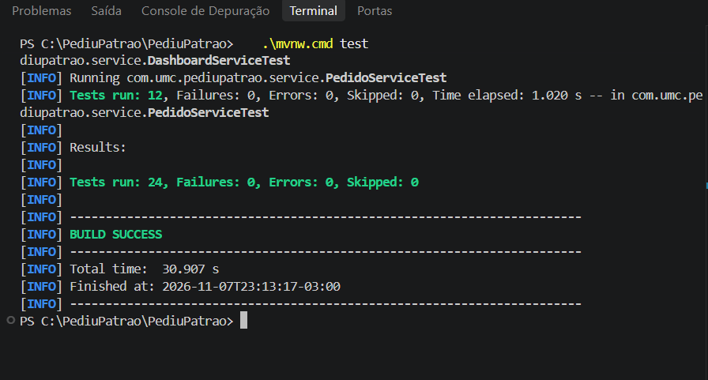
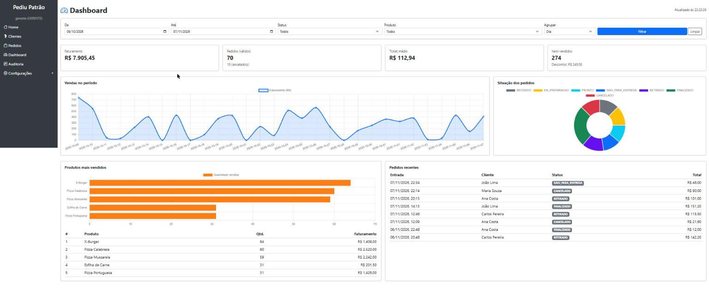
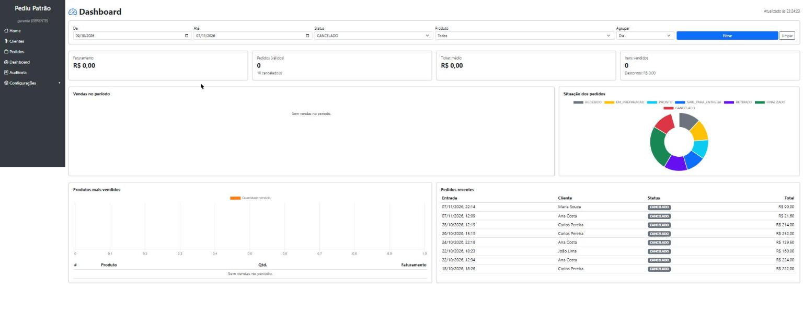
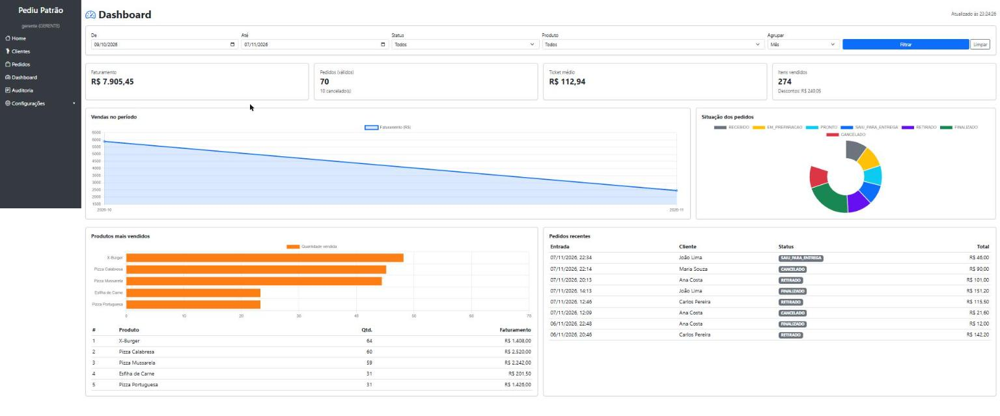
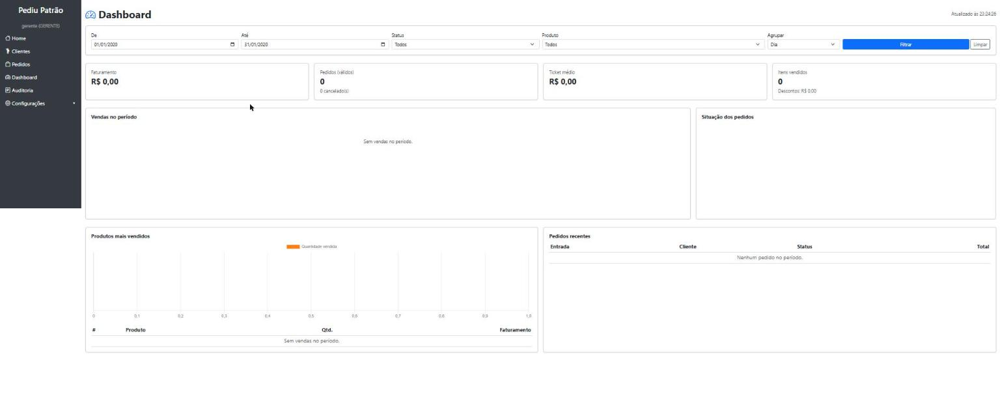
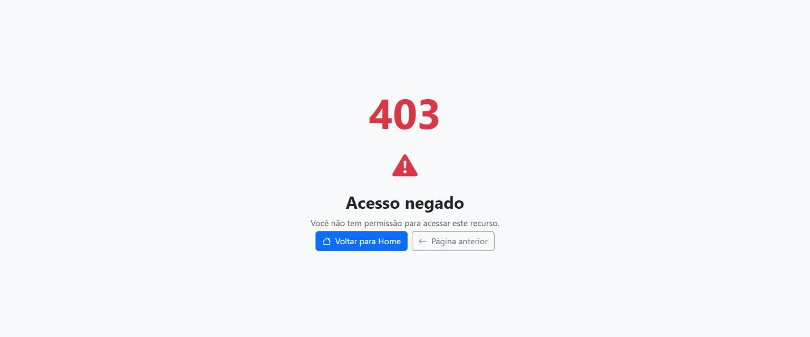

# Dashboard Administrativo — PediuPatrão

Atividade Prática: Dashboard Administrativo. Evolução do sistema de pedidos (Java 21, Spring Boot 3.4, Spring Security, Thymeleaf, MongoDB Atlas).

## 1. Visão geral e decisões de projeto

- O dashboard é uma página Thymeleaf (`/dashboard`) que **consome a API REST própria** `/api/dashboard/*` com `fetch` (JavaScript). A tela não acessa o banco; só a API acessa.
- Os gráficos usam **Chart.js** (via CDN) por ser simples, sem build e suficiente para linhas, barras e rosca.
- A API fica em uma camada própria (`DashboardController` → `DashboardService` → `PedidoRepository`). Os cálculos ficam no serviço, e o controller só recebe parâmetros e devolve JSON.
- Cada endpoint devolve um **DTO** (`record`) com só o que o gráfico precisa, sem expor a entidade `Pedido` inteira.
- **Regra de negócio:** pedido `CANCELADO` **não é venda**. Ele não entra em faturamento, ticket médio, gráfico de vendas nem ranking, mas aparece na contagem de cancelados e no gráfico de situação dos pedidos.
- **Segurança:** só `ADMIN` e `GERENTE` acessam `/dashboard` e `/api/dashboard/**` (regra no `SecurityConfig` e `@PreAuthorize` no controller). O `ATENDENTE` recebe 403.
- Os pedidos do período são lidos com uma consulta por data (`findByDataEntradaBetween`) e agregados em memória. Isso atende bem uma pizzaria. Para um volume muito maior, o próximo passo seria usar o *aggregation pipeline* do MongoDB.

## 2. Requisitos

### 2.1 Funcionais

| Id | Requisito | Onde está |
|---|---|---|
| RF01 | Indicadores gerais: faturamento, nº de pedidos, cancelados, ticket médio, itens vendidos e descontos | `GET /api/dashboard/resumo` + cartões da tela |
| RF02 | Análise de vendas em gráfico, por dia ou por mês | `GET /api/dashboard/vendas-por-periodo` + gráfico de linha |
| RF03 | Situação dos pedidos (quantidade por status) e pedidos recentes | `GET /api/dashboard/pedidos-por-status`, `GET /api/dashboard/pedidos-recentes` + rosca e tabela |
| RF04 | Produtos mais vendidos (ranking) | `GET /api/dashboard/produtos-mais-vendidos` + barras e tabela |
| RF05 | Filtros: período, status e produto (e agrupamento dia/mês) | Parâmetros da API + formulário de filtros |
| RF06 | Integração com a API | A tela só obtém dados via `fetch('/api/dashboard/...')` |
| RF07 | Atualização e tratamento de dados | Atualização automática a cada 60 s, indicador de carregamento, mensagens de erro, tratamento de lista vazia e de dados antigos (nulos) |

### 2.2 Não funcionais

| Id | Requisito | Como foi atendido |
|---|---|---|
| RNF01 | Segurança | Acesso restrito a ADMIN/GERENTE no backend; CSRF ativo; textos escapados na tela (evita XSS) |
| RNF02 | Desempenho | Uma consulta por data por endpoint; as 5 chamadas da tela rodam em paralelo (`Promise.all`); período máximo de 366 dias |
| RNF03 | Usabilidade | Padrão de 30 dias sem precisar filtrar; layout responsivo (Bootstrap) |
| RNF04 | Confiabilidade | Parâmetros inválidos retornam 400 com mensagem clara; a tela mostra o erro sem quebrar |
| RNF05 | Manutenibilidade | Camadas separadas, DTOs, testes unitários dos cálculos |
| RNF06 | Precisão financeira | Valores em `BigDecimal` com 2 casas e arredondamento HALF_UP |

## 3. Documentação dos endpoints

Base: `http://localhost:8080`. Todos os endpoints são **GET**, exigem login (sessão) e perfil **ADMIN** ou **GERENTE**.

**Filtros comuns** (todos opcionais):

| Parâmetro | Formato | Padrão | Observação |
|---|---|---|---|
| `inicio` | `AAAA-MM-DD` | 29 dias antes de `fim` | início do período (inclusive) |
| `fim` | `AAAA-MM-DD` | hoje | fim do período (inclusive) |
| `status` | nome do status | todos | `RECEBIDO`, `EM_PREPARACAO`, `PRONTO`, `SAIU_PARA_ENTREGA`, `RETIRADO`, `FINALIZADO`, `CANCELADO` |
| `produtoId` | id do produto | todos | só pedidos que contêm esse produto |

### 3.1 `GET /api/dashboard/resumo`
Parâmetros: `inicio`, `fim`, `status`, `produtoId`.

Exemplo: `GET /api/dashboard/resumo?inicio=2026-11-01&fim=2026-11-07`
```json
{
  "inicio": "2026-11-01",
  "fim": "2026-11-07",
  "faturamentoTotal": 4820.50,
  "totalPedidos": 31,
  "pedidosValidos": 28,
  "pedidosCancelados": 3,
  "ticketMedio": 172.16,
  "descontosConcedidos": 96.40,
  "itensVendidos": 74
}
```

### 3.2 `GET /api/dashboard/vendas-por-periodo`
Parâmetros: `inicio`, `fim`, `status`, `produtoId` e `agrupamento` (`DIA` padrão, ou `MES`). No agrupamento por dia, os dias sem venda aparecem com zero.

Exemplo: `GET /api/dashboard/vendas-por-periodo?inicio=2026-11-01&fim=2026-11-03&agrupamento=DIA`
```json
[
  { "periodo": "2026-11-01", "pedidos": 4, "faturamento": 612.00 },
  { "periodo": "2026-11-02", "pedidos": 0, "faturamento": 0.00 },
  { "periodo": "2026-11-03", "pedidos": 6, "faturamento": 905.40 }
]
```

### 3.3 `GET /api/dashboard/pedidos-por-status`
Parâmetros: `inicio`, `fim`, `produtoId` (não aceita `status`, pois mostra todos). Sempre devolve os 7 status, na ordem do fluxo.

```json
[
  { "status": "RECEBIDO", "quantidade": 2 },
  { "status": "EM_PREPARACAO", "quantidade": 1 },
  { "status": "PRONTO", "quantidade": 0 },
  { "status": "SAIU_PARA_ENTREGA", "quantidade": 1 },
  { "status": "RETIRADO", "quantidade": 3 },
  { "status": "FINALIZADO", "quantidade": 21 },
  { "status": "CANCELADO", "quantidade": 3 }
]
```

### 3.4 `GET /api/dashboard/produtos-mais-vendidos`
Parâmetros: `inicio`, `fim`, `status`, `limite` (1 a 50, padrão 5). Ordenado pela quantidade vendida; empate resolvido pelo nome. Ignora pedidos cancelados.

Exemplo: `GET /api/dashboard/produtos-mais-vendidos?limite=2`
```json
[
  { "produtoId": "65f1...a1", "nome": "Pizza Calabresa", "quantidadeVendida": 23, "faturamento": 966.00 },
  { "produtoId": "65f1...b2", "nome": "Coca-Cola 2L", "quantidadeVendida": 17, "faturamento": 204.00 }
]
```

### 3.5 `GET /api/dashboard/pedidos-recentes`
Parâmetros: `inicio`, `fim`, `status`, `produtoId`, `limite` (1 a 50, padrão 10). Do mais novo para o mais antigo.
```json
[
  { "id": "6720...", "cliente": "Maria Souza", "status": "RECEBIDO", "valorTotal": 84.00, "dataEntrada": "2026-11-07T19:42:10" }
]
```

### 3.6 Erros possíveis

| Código | Quando | Corpo |
|---|---|---|
| 400 | Data fora do formato | `{"erro":"Data inválida no parâmetro 'inicio'. Use o formato AAAA-MM-DD."}` |
| 400 | `inicio` maior que `fim` | `{"erro":"A data inicial não pode ser maior que a data final."}` |
| 400 | Período maior que 366 dias | `{"erro":"O período máximo de consulta é de 366 dias."}` |
| 400 | Status inexistente | `{"erro":"Status inválido: XYZ"}` |
| 400 | `agrupamento` diferente de DIA/MES | `{"erro":"Agrupamento inválido. Use DIA ou MES."}` |
| 400 | `limite` fora de 1–50 | `{"erro":"O limite deve estar entre 1 e 50."}` |
| 400 | `limite=abc` (tipo errado) | `{"erro":"Valor inválido para o parâmetro 'limite'."}` |
| 302 | Sem login | redireciona para `/login` |
| 403 | Logado como ATENDENTE | acesso negado |

## 4. Evidências de testes

### 4.1 Testes automatizados
Arquivo: `src/test/java/com/umc/pediupatrao/service/DashboardServiceTest.java` (também existe `PedidoServiceTest`). Execute com `./mvnw test`.

| Teste | O que verifica |
|---|---|
| resumoNaoContaPedidoCancelado | cancelado fica fora do faturamento, do ticket e dos itens; entra na contagem de cancelados |
| resumoSemPedidosTemTicketZero | não divide por zero |
| filtroDeStatusFunciona / filtroDeProdutoFunciona | filtros RF05 |
| vendasPorDiaPreencheDiasSemVenda | dias sem venda aparecem com zero |
| vendasPorMesAgrupaNoMes | agrupamento mensal |
| agrupamentoInvalidoEhRejeitado | erro 400 |
| pedidosPorStatusListaTodosOsStatus | sempre 7 status |
| rankingOrdenaPorQuantidadeEIgnoraCancelados / rankingRespeitaOLimite | RF04 |
| parametrosInvalidosSaoRejeitados | data inválida, período invertido ou longo, status e limite inválidos |
| semParametrosUsaUltimos30Dias | período padrão |

   **Resultado da execução:** `Tests run: 24, Failures: 0, Errors: 0, Skipped: 0` — BUILD SUCCESS.

   

### 4.2 Testes manuais (preencher com prints)

| # | Passo | Resultado esperado | Print |
|---|---|---|---|
| 1 | Login como `gerente` e abrir `/dashboard` | Cartões, 3 gráficos e 2 tabelas aparecem | |
| 2 | Filtrar um período de 7 dias | Todos os blocos mudam | |
| 3 | Filtrar status `CANCELADO` | Faturamento zerado; cancelados > 0 | |
| 4 | Filtrar por um produto | Só pedidos com o produto | |
| 5 | Trocar agrupamento para Mês | Gráfico com um ponto por mês | |
| 6 | Período sem pedidos (ex.: 2020) | Mensagem "Sem vendas no período" e tabelas vazias | |
| 7 | Chamar `/api/dashboard/resumo?inicio=abc` | 400 com mensagem | |
| 8 | Login como `atendente` e abrir `/dashboard` | 403 | |
| 9 | Deixar a tela aberta 1 minuto | "Atualizado às" muda sozinho | |

### Prints dos testes manuais












## 5. Como executar e demonstrar
1. Configure a string do MongoDB Atlas em `application.properties`.
2. Para ter dados na demonstração, troque `pediupatrao.dados-demo=true`, rode uma vez e volte para `false`. Os pedidos de exemplo ficam marcados com responsável "demo".
3. Entre com `gerente` / `teste123` e abra **Dashboard** no menu lateral.
